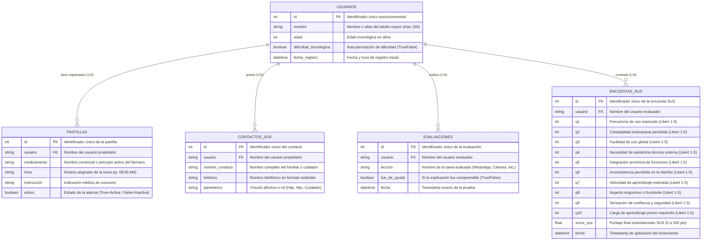

# Diagrama Entidad-Relación (DER) y Diccionario de Datos

## Proyecto "Cley's HelpMe" (Clara) — Tesis de Grado
**Sistema de Asistencia Integral y Alfabetización Digital para Adultos Mayores**  
**Institución Beneficiaria:** Casa De Los Abuelos de Miranda  

---

## 1. Diagrama Entidad-Relación (Modelo Conceptual y Lógico)

A continuación se presenta el modelo Entidad-Relación estructurado para el sistema, reflejando las entidades principales, sus atributos tipados, claves primarias (`PK`), claves foráneas lógicas (`FK`) y las cardinalidades de cada asociación:

---

## 2. Diccionario de Datos

### 2.1. Entidad: `USUARIOS` (Tabla: `usuarios`)
Almacena el perfil básico y las características sociodemográficas del adulto mayor.

| Campo | Tipo de Dato | Nulo | Clave | Descripción |
| :--- | :--- | :---: | :---: | :--- |
| `id` | `INTEGER` | NO | **PK** | Clave primaria autoincremental única. |
| `nombre` | `VARCHAR(100)` | NO | - | Nombre de pila con el que Cley interactúa afectuosamente. |
| `edad` | `INTEGER` | NO | - | Edad cronológica del usuario (usado para calibrar la velocidad del habla). |
| `dificultad_tecnologica` | `BOOLEAN` | NO | - | Indicador de brecha digital (`True` = requiere explicaciones más minuciosas). |
| `fecha_registro` | `DATETIME` | NO | - | Fecha y hora en la que el usuario completó el *onboarding*. |

---

### 2.2. Entidad: `PASTILLAS` (Tabla: `pastillas`)
Gestiona el cronograma farmacológico diario del adulto mayor.

| Campo | Tipo de Dato | Nulo | Clave | Descripción |
| :--- | :--- | :---: | :---: | :--- |
| `id` | `INTEGER` | NO | **PK** | Clave primaria única del medicamento registrado. |
| `usuario` | `VARCHAR(100)` | NO | **FK / Index** | Referencia al usuario propietario del pastillero. |
| `medicamento` | `VARCHAR(200)` | NO | - | Denominación del medicamento (ej: *Losartán Potásico 50mg*). |
| `hora` | `VARCHAR(20)` | NO | - | Hora programada de la dosis (ej: *08:00 AM* o *01:00 PM*). |
| `instruccion` | `VARCHAR(500)` | SÍ | - | Pauta médica de administración (ej: *Tomar con medio vaso de agua después del desayuno*). |
| `activo` | `BOOLEAN` | NO | - | Estado de la alerta (`True` = Activa, `False` = Pausada). |

---

### 2.3. Entidad: `CONTACTOS_SOS` (Tabla: `contactos_sos`)
Almacena la libreta de contactos de emergencia para auxilio inmediato.

| Campo | Tipo de Dato | Nulo | Clave | Descripción |
| :--- | :--- | :---: | :---: | :--- |
| `id` | `INTEGER` | NO | **PK** | Clave primaria única del contacto de auxilio. |
| `usuario` | `VARCHAR(100)` | NO | **FK / Index** | Referencia al usuario propietario de la alerta. |
| `nombre_contacto` | `VARCHAR(150)` | NO | - | Nombre del familiar, tutor o médico de cabecera. |
| `telefono` | `VARCHAR(50)` | NO | - | Número de teléfono nacional o internacional directo. |
| `parentesco` | `VARCHAR(100)` | NO | - | Relación filial o profesional (ej: *Hija Mayor*, *Médico*, *Hermano*). |

---

### 2.4. Entidad: `EVALUACIONES` (Tabla: `evaluaciones`)
Registra la retroalimentación inmediata del adulto mayor tras finalizar una lección interactiva.

| Campo | Tipo de Dato | Nulo | Clave | Descripción |
| :--- | :--- | :---: | :---: | :--- |
| `id` | `INTEGER` | NO | **PK** | Clave primaria única del evento de evaluación. |
| `usuario` | `VARCHAR(100)` | NO | **FK / Index** | Referencia al usuario que realizó la práctica. |
| `leccion` | `VARCHAR(150)` | NO | - | Tarea completada (*Audio de WhatsApp*, *Tomar Foto*, *Llamar*). |
| `fue_de_ayuda` | `BOOLEAN` | NO | - | `True` si el usuario consideró que la explicación fue clara y útil. |
| `fecha` | `DATETIME` | NO | - | Marca de tiempo del registro. |

---

### 2.5. Entidad: `ENCUESTAS_SUS` (Tabla: `encuestas_sus`)
Estructura psicométrica estandarizada bajo el protocolo internacional **System Usability Scale (SUS)** de John Brooke (1986) para medir el nivel de usabilidad de la aplicación en la tesis.

| Campo | Tipo de Dato | Nulo | Clave | Escala / Rango | Descripción |
| :--- | :--- | :---: | :---: | :---: | :--- |
| `id` | `INTEGER` | NO | **PK** | Autoincremental | Clave primaria de la prueba de usabilidad. |
| `usuario` | `VARCHAR(100)` | NO | **FK** | Texto | Nombre del evaluador participante. |
| `q1` a `q10` | `INTEGER` | NO | - | 1 a 5 | Puntuación Likert de los 10 reactivos estandarizados SUS. |
| `score_sus` | `FLOAT` | NO | - | 0.0 a 100.0 | **Puntaje Compuesto SUS:** Calculado mediante la fórmula: `((Σ impares - 5) + (25 - Σ pares)) * 2.5`. Un valor >= 68.0 indica usabilidad superior al promedio. |
| `fecha` | `DATETIME` | NO | - | Timestamp | Fecha y hora en la que se aplicó el instrumento de campo. |

---

## 3. Justificación de la Arquitectura de Persistencia Híbrida

Para responder a las limitaciones técnicas reales de la residencia de adultos mayores (donde la conexión a internet puede ser intermitente), el sistema implementa una persistencia en dos niveles:

1. **Almacenamiento Local en el Dispositivo (Móvil):**
   * El modelo relacional se replica localmente en formato clave-valor persistente con **Android SharedPreferences** a través del servicio nativo `@capacitor/preferences`.
   * **Beneficio:** Garantiza una latencia de 0 ms en la lectura del pastillero y el botón SOS, funcionando con total autonomía sin depender de red.
2. **Servidor Centralizado de Métricas (Backend):**
   * El backend Python con **FastAPI + SQLAlchemy** sincroniza estos registros en el archivo relacional `cley_helpme_v2.db` (SQLite) y en la nube (PostgreSQL/Supabase) para que los investigadores y tesistas puedan generar gráficos estadísticos de adopción tecnológica y usabilidad.

